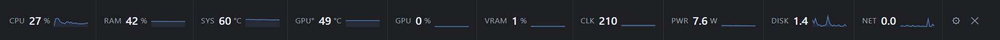
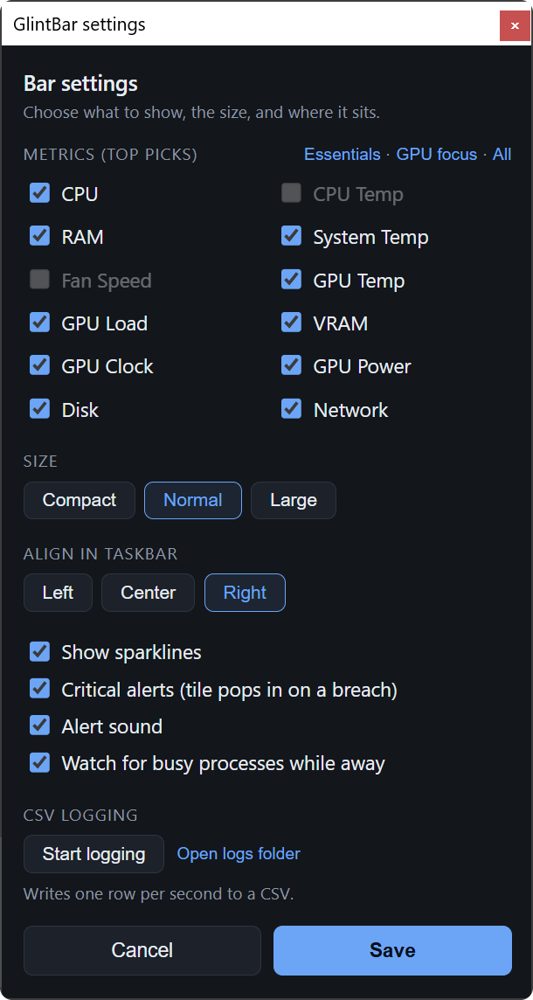

# GlintBar



[](#supported-hardware-and-platforms)
[](https://pypi.org/project/glintbar/)
[](https://github.com/paone9/GlintBar/actions/workflows/ci.yml)
[](https://github.com/paone9/GlintBar/actions/workflows/codeql.yml)
[](https://scorecard.dev/viewer/?uri=github.com/paone9/GlintBar)
[](LICENSE)

GlintBar turns the empty gap in your Windows taskbar into a live hardware
monitor: no window to keep open, no screen space given up. CPU, RAM, GPU,
temperatures, disk, and network sit there at a glance, each with a 60-second
sparkline and a hover-to-expand graph. Temperature, CPU, RAM and VRAM spikes
raise an alert tile, and with clock and power on-screen you can catch a GPU clock
collapse or power dropout, the fingerprint of a driver hang, before it turns into
a stutter or a crash.

## What it shows

A single row of up to twelve metrics, each with a value and a 60-second sparkline.
Hover a metric to pop out a bigger live graph with the session min, max and
average.

| Tile | Source | Watch for |
|------|--------|-----------|
| GPU Temp | nvidia-smi | amber >80 °C, red >87 °C |
| GPU Load | nvidia-smi / perf counters | sustained 100% |
| VRAM | nvidia-smi | red >95 % |
| GPU Power | nvidia-smi | sudden dropouts under load |
| GPU Clock | nvidia-smi | dropping to idle mid-load can mean a TDR hang |
| SYS Temp | ACPI thermal zone | red >97 °C |
| CPU Temp | HWiNFO or LibreHardwareMonitor | real CPU package temp (needs a helper, see below) |
| Fan | HWiNFO or LibreHardwareMonitor | fan RPM (needs a helper, see below) |
| CPU | psutil | red >95 % |
| RAM | psutil | red >95 % |
| Network | psutil | MB/s in+out |
| Disk | psutil | MB/s read+write |

Everything comes from first-party or open-source sources and runs without admin
rights. The bar only shows tiles your machine can actually provide (details
below).

## Supported hardware and platforms

**Windows 10 and 11 only.** It's built on Win32 APIs (the taskbar, DPI, and
sensors), so there is no macOS or Linux build.

CPU, RAM, disk and network work on any Windows PC, via `psutil`.

GPU support is detected at launch:

| GPU | Load | VRAM | Temp | Clock | Power | Source |
|-----|:----:|:----:|:----:|:-----:|:-----:|--------|
| NVIDIA | ✅ | ✅ | ✅ | ✅ | ✅ | `nvidia-smi` (driver) |
| AMD / Intel / other | ✅ | — | — | — | — | Windows GPU perf counters |
| No GPU / headless | — | — | — | — | — | GPU tiles hidden |

AMD and Intel GPUs get load only. Temp, clock, power and VRAM need NVIDIA. The
settings panel greys out anything your hardware can't provide.

### Privilege levels: it works without admin, and does more with it

GlintBar always runs unprivileged and never needs admin. As a normal user you get
CPU, RAM, disk, network, GPU (per the table above), and the SYS Temp tile:
everything except real CPU temperature and fan speed. Those two need kernel-level
access, so they come from a separate helper that has admin (see below); GlintBar
just reads what it exposes and stays unprivileged itself.

The SYS Temp tile reads the ACPI thermal zone through a Windows performance
counter, so it needs no admin. It's a generic zone though, so treat it as a rough
system-heat reading, not the exact CPU-package sensor, and some machines block it.

Real per-core CPU temperature and fan RPM need kernel-level access, which no
no-admin tool can do. For those, run a helper that already does the low-level
reads with admin, and GlintBar reads from it while staying at normal privilege.
It picks up the extra **CPU Temp** and **Fan** tiles automatically when one is
present. Two options, whichever you already use:

**HWiNFO** (via shared memory): in HWiNFO, open Settings and tick **Shared Memory
Support**. That's it. GlintBar reads the shared-memory block directly (no network
at all). This is easiest if you already run HWiNFO.

**LibreHardwareMonitor** (open source, via a local web server): in its Options
menu turn on **Remote Web Server** (default port 8085). GlintBar reads only from
`http://127.0.0.1:8085` on your own machine, never the internet. Use
`GLINTBAR_LHM_PORT` if you change the port.

Either way, start the helper before GlintBar (or restart GlintBar) and the tiles
appear on their own. HWiNFO is preferred if both are running.

### Requirements

Python 3.10+ and the WebView2 runtime, which already ships with Windows 11;
Windows 10 usually has it via Edge, but may need the free Evergreen runtime. No
admin needed. GlintBar itself is plain Python source with no compiled binaries of
its own. Its direct dependencies are `pywebview`, `psutil`, and `taskbargap`
(taskbar-gap detection and placement, extracted from this project), installed
automatically; `psutil` and pywebview's `pythonnet` do ship compiled code.

## Install and run

The simplest install (adds a `glintbar` command):

```
pip install glintbar
glintbar
```

Or with `pipx` for a fully isolated install: `pipx install glintbar`.

From a clone, for hacking on it:

```
pip install -e .
python -m glintbar
```

Contributor tooling (lint + tests) installs with `pip install -e .[dev]`; then
run `ruff check .` and `pytest`.

For a launch with no console window, use the installed `glintbar` command; from a
clone, double-click `start_glintbar.cmd`. To start it on login, drop a shortcut to
the `glintbar` command into `shell:startup` (Win+R, then `shell:startup`).

Controls sit on the right: the gear opens settings and ✕ closes. While CSV
logging is recording, a small red dot flashes on the bar; starting/stopping it
and opening the logs folder are in settings.

Settings and logs live in `%LOCALAPPDATA%\GlintBar` (`config.json` and `logs\`),
so they survive reinstalls and stay out of the install folder.

## Settings



Open the gear to change:

- Metrics: pick the ones you want, with presets for Essentials, GPU focus, or
  All. The bar rebuilds and resizes to fit only what you keep, up to the width
  of the taskbar gap; past that the tiles scroll.
- Size: Compact, Normal, or Large.
- Align: Left, Center, or Right within the taskbar gap.
- Sparklines, critical alerts, alert sound, and away watch: on or off.
- CSV logging: start or stop it, and open the logs folder.

Your choices are saved to `config.json` in `%LOCALAPPDATA%\GlintBar`. A few
options have no toggle and live only in that file: `temp_unit` (`"C"` or `"F"`,
default `"C"`) to show temperatures in Fahrenheit, and `hotkey` (the hide/show
shortcut, default `"ctrl+alt+g"`, `""` to disable).

## Placement

Set `DOCK` in `glintbar/monitor.py`:

- `"taskbar"` (default) floats a topmost bar over the empty part of the taskbar,
  between your app buttons and the system tray. It's a normal top-level window
  that sits above the Windows 11 taskbar's input layer, so its hovers and clicks
  work and it uses no extra screen space. A small background thread keeps it
  fitted to the gap and on top as apps open and close. On Windows 11 the gap is
  measured from the buttons the taskbar actually draws (Start, Search, every
  app, Widgets), read through the taskbar's own accessibility tree, so the bar
  never sits on one of them. The bar is sized to the tiles you picked, and when
  the gap is too short for all of them it takes what is free and the tiles
  scroll sideways instead: move the mouse across them (or use the wheel) and
  they follow, with a fade at whichever edge has more. The bar appears once, at
  its final size, rather than at a placeholder width first.
- `"bottom"` is a thin full-width strip just above the taskbar.
- `"top"` is a thin full-width strip at the top of the screen.

It lives on your **primary monitor's** taskbar (the one Windows treats as
primary), and expects that taskbar along the bottom. On a multi-monitor setup with
different scaling per monitor it stays correctly placed and sized, since the app is
per-monitor-DPI aware. Only one copy runs at a time; launching it again while it
is open shows a message saying it's already running and starts nothing, so close
the running bar first (✕ on the bar) if you want to restart it. Letting you pick a different monitor is on the
[roadmap](ROADMAP.md).

When a video, game, or slideshow goes fullscreen on the same screen, the bar
hides itself so it's not in the way, and it comes back when you exit fullscreen.

If the taskbar fills up and the gap gets too small to fit even a minimal bar, it
steps aside on its own rather than cover your app buttons, and returns when
there's room. To hide or show it yourself at any time, press **Ctrl+Alt+G**
(change the combo or disable it with `hotkey` in `config.json`). On Windows 10,
or if the Windows 11 taskbar's accessibility tree can't be read, the app-button
edge is a corroborated estimate rather than a measurement; the bar then keeps
extra distance from it and anchors right, and the hotkey is there if it still
ends up over something.

## Hover to expand

Hover a metric and a bigger popup appears just above it with a full 60-second
graph, the current value, and min/max/avg. It disappears when you move off.

## Critical alerts

When a metric crosses a critical threshold (a temperature past its red line, or
CPU, RAM or VRAM over 95%), an extra tile appears at the end of the bar. It's added rather
than swapped in, so your other tiles don't move, and it stays until things settle
(about two seconds to appear, with a short cooldown before it clears). There's an
optional beep on a new alert so you notice without watching. Both are toggles in
settings.

## Away watch

If you step away and the machine keeps working hard, GlintBar figures out what was
responsible and tells you when you get back. It counts you as away as soon as the
screen is locked, or after a few minutes with no keyboard or mouse activity. While
you're away and the CPU stays high, it records which processes are behind it. When
you return, if you were counted as away for at least 5 minutes (so after an idle
start, about 10 minutes since your last input), it shows a short summary (how long
you were away, how much of it was busy, the peak CPU and temperature, how RAM
moved, and the busiest processes) and appends a line to `away.csv` in the logs
folder. The summary appears even when nothing stood out, so a quiet night reads as
"nothing happened" rather than silence. The alert beep (if alert sound is on) is
kept for absences that were notable: CPU busy or running hot for a sustained
stretch, or memory that climbed and stayed high.

Toggle it in settings. The thresholds are in `config.json`: `away_after_min`
(idle minutes before you count as away, default 5), `away_cpu_pct` (busy at or above
this CPU %, default 25), `away_hot_c` (hot at or above this °C, default 85), and
`away_report_after_min` (minutes counted as away before a summary is worth
showing, default 5).

## CSV logging

Start CSV logging from settings to write one row per second, with every metric, to
a timestamped file in `%LOCALAPPDATA%\GlintBar\logs`. The bar shows a flashing red
dot while it records. Open the CSV in pandas or Excel and line it up against a
workload timeline to see how throttling, thermal drift or power dropouts track
with load.

```python
import pandas as pd
df = pd.read_csv("logs/glintbar_<timestamp>.csv", parse_dates=["timestamp"])
df.set_index("timestamp")[["gpu_temp", "gpu_clock", "gpu_power"]].plot()
```

## Notes

- It adapts to any resolution and display scaling; DPI is read at runtime.
- Light footprint: CPU, RAM, disk and network update every second, while the GPU
  (which means spawning `nvidia-smi`) is polled every two seconds and cached in
  between, so the monitor itself stays cheap.
- Thresholds live in the `META` map at the top of `glintbar/ui.html`, so they're
  easy to change.
- `python -m glintbar --diag` prints what GlintBar detects on this machine
  (Python and Windows versions, DPI, sensor providers, taskbar geometry and
  timings) to the console and exits without starting the bar. It writes no
  diagnostic file; like any launch, it creates the empty `%LOCALAPPDATA%\GlintBar`
  folders if they don't exist yet.
- Ideas that aren't built yet (attention rotation, anomaly detection, toast
  notifications, AMD/Intel temperatures) are written up in [ROADMAP.md](ROADMAP.md).

## Security

GlintBar is meant to be easy to review. It's plain Python with no binaries of its
own and no obfuscation, it needs no admin, and it makes no internet connections:
no telemetry, no update checks, nothing. The only network use is local: when
HWiNFO's shared memory isn't available, it checks once at startup for
LibreHardwareMonitor on `127.0.0.1:8085` (or `GLINTBAR_LHM_PORT`), and keeps
reading it only if it answers with CPU temperature or fan data. It only reads system metrics and writes `config.json`, logs, and its WebView2
browser profile (kept persistent so it doesn't leak a fresh copy into `%TEMP%`
on every launch) to `%LOCALAPPDATA%\GlintBar`.

CI runs `ruff` and `bandit`, plus the unit tests on Windows (Python 3.10 and
3.13), on every push to `main` and every pull request, and a `CodeQL` workflow runs
semantic static analysis of the Python, the UI JavaScript, and the workflows
themselves. GitHub Actions are pinned to commit SHAs. Dependabot keeps those and
the pinned dev tools up to date. In `pyproject.toml`, `pywebview` and `psutil` sit
at minimum-tested floors and `taskbargap` is pinned to its 0.2 minor (`~=0.2.0`),
since a 0.x library may break its API between minors. An
[OpenSSF Scorecard](https://scorecard.dev/viewer/?uri=github.com/paone9/GlintBar)
grades the repo's security posture (badge above). See the repo's Security tab, and
[SECURITY.md](SECURITY.md) for exactly what the app touches.

## License

MIT. See [LICENSE](LICENSE).
